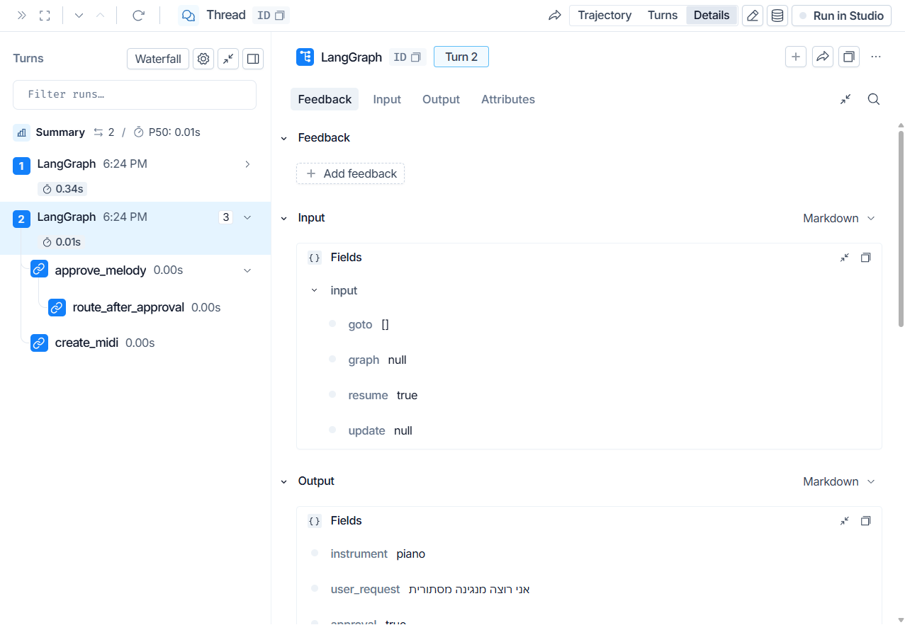
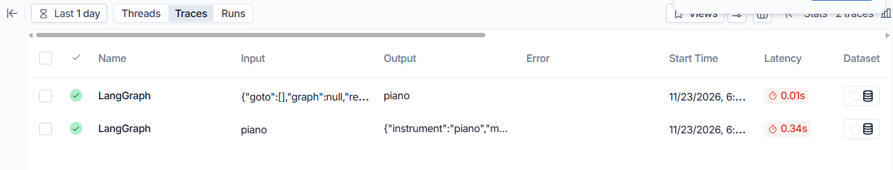
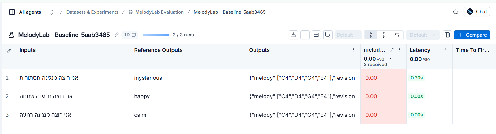
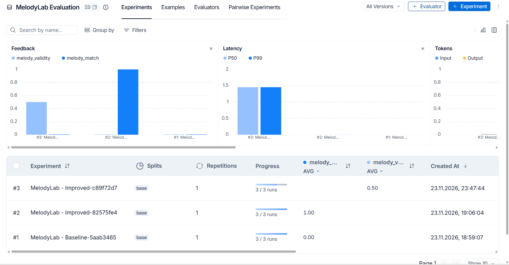

# MelodyLab 🎵

## Project Overview

MelodyLab is a music generation project built with Python and LangGraph.

The system receives a music request, analyzes the requested mood and musical settings, generates a melody, and asks the user to approve it before creating a MIDI file.

## Technologies

- Python
- LangGraph
- LangSmith
- Mido
- python-dotenv

## Workflow

The LangGraph workflow includes:

1. Analyze the user's request.
2. Generate a melody according to the requested mood.
3. Ask the user to approve the melody using Human-in-the-Loop.
4. If approved, create a MIDI file.
5. If rejected, revise the melody and ask for approval again.

The graph uses conditional routing and a revision loop.

## Human-in-the-Loop

The project uses LangGraph's `interrupt` mechanism to pause execution and wait for human approval.

The user can approve or reject the generated melody.

## LangSmith Evaluation

A LangSmith Dataset named `MelodyLab Evaluation` was created with three test cases:

- Mysterious mood
- Happy mood
- Calm mood

An automated evaluator compares the generated melody with the expected melody.

### Baseline Experiment

The original generator returned the same melody regardless of the requested mood.

Result: 0.00 average score.

### Improved Experiment

The generator was improved to select a different melody according to the requested mood.

Result: 1.00 average score.

## Traces and Evaluation Results

### LangGraph Trace

### Baseline Results

### Improved Results

## Insight

The LangSmith experiments showed that the original generator ignored the requested mood and therefore failed all three test cases.

After changing the generator to use the mood as an input, all three test cases passed.

This demonstrates how automated evaluation can identify a weakness and measure the effect of an improvement.
## התובנה שלי :
checkpointing- langraph
ומה תפקידו של thread-id?
## הסבר:
chekpointing -מנגנון ששומר מצב הגרף בנקודות שונות במהלך הריצה  
thread_id - 
באמצעותו ניתן לשמור נקודה מסוימת במהלך
וכך ניתן לחזור לאותו תהליך מבלי לאבד ולבלבל בין תהליכים שונים שרצים
